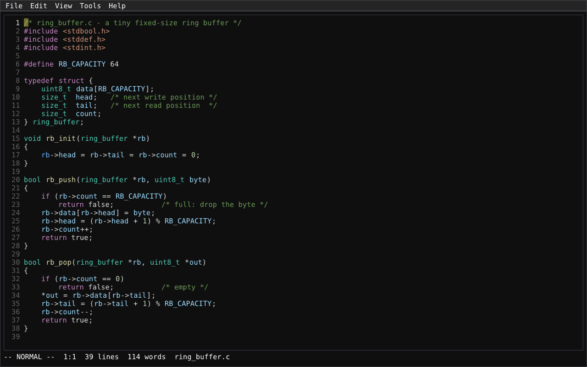

# zedit

A modal, vim-like text editor written in C++20, built on Dear ImGui + GLFW + OpenGL.
Targets Linux and macOS. The binary is `ze` — short to type, like `vi`. Think
gedit's approachable GUI chrome (menus, mouse support, a file browser) layered
over neovim's modal, keyboard-driven editing power.



## Features

- Modal editing: Normal/Insert/Visual/Visual Line/Command-line/Search modes,
  motions (`hjkl`, `w`/`b`/`e`, `0`/`$`, `%` bracket matching, `G`/`gg`/`:N`
  line jumps), operators (`d`/`y`/`c`) composable with counts and motions,
  registers (named and unnamed), undo/redo, dot-repeat, auto-indent
- Multiple buffers and windows (`:e`, `:bn`/`:bp`, `:sp`/`:vsp`, Ctrl-W),
  side-by-side file compare (`:diff`)
- Syntax highlighting via tree-sitter (C++, Python, Markdown), a line-numbers
  gutter, matching-bracket highlight, and optional word wrap and whitespace
  visualization (View menu)
- LSP client (clangd): live diagnostics, go-to-definition (`gd`), hover (`K`)
- Lua-based configuration: `~/.config/zedit/init.lua` sets options, colors,
  and keymaps via a small `zedit.*` API; `:lua <code>` runs Lua live as a
  scripting hook
- GUI-editor shortcuts alongside the modal keybindings: Ctrl-A (select all),
  Ctrl-C (copy), Ctrl-P or Ctrl-V (paste), Ctrl-S (save) — all work mid-Insert too
- System clipboard integration: yanks and cuts land on the desktop clipboard,
  and text copied in other apps is what the next unnamed paste inserts
  (like vim's `clipboard=unnamedplus`; named registers stay local). Paste
  always inserts plain text: copies that carry only HTML or RTF (some
  Electron/Chromium and Mac apps) are converted to plain text, on macOS and
  on Linux (X11 and Wayland). On Wayland this uses `wl-paste` from
  [wl-clipboard](https://github.com/bugaevc/wl-clipboard) when installed
  (the `.deb` recommends it); without it, Wayland pastes plain text only
- Menu bar (File/Edit/View/Tools/Help): a directory-tree file browser and
  recent-files list for Open, Find and Replace, Tools > Sort Lines
- Mouse-wheel scrolling, click-to-position, status bar (mode, cursor
  position, word count, file path)
- A backstop max file size (256 MB) against accidentally opening something
  never meant to fit in memory whole


## Crash recovery

Unsaved edits to named files are periodically written to a hidden swap file
under the platform cache directory (not next to the project file). On reopen,
zedit offers to recover or discard. See [docs/crash-recovery.md](docs/crash-recovery.md).

## Status

Core roadmap (M0–M7) complete: scaffolding, editing/motions/operators,
undo/registers/Visual mode, search/buffers, syntax highlighting, splits/diff,
LSP, and the Lua config system. Actively growing from there.

## Installing

**Linux (.deb):** download the latest release from
[github.com/sbj-ee/zedit/releases/latest](https://github.com/sbj-ee/zedit/releases/latest)
(currently
[zedit-1.7.4-Linux-amd64.deb](https://github.com/sbj-ee/zedit/releases/download/v1.7.4/zedit-1.7.4-Linux-amd64.deb))
and install with:

```sh
sudo dpkg -i zedit-1.7.4-Linux-amd64.deb
```

**macOS (.dmg, Apple Silicon only):** download the latest release from
[github.com/sbj-ee/zedit/releases/latest](https://github.com/sbj-ee/zedit/releases/latest)
(currently
[zedit-1.7.4-Darwin.dmg](https://github.com/sbj-ee/zedit/releases/download/v1.7.4/zedit-1.7.4-Darwin.dmg)),
open it, and drag `ze.app` to Applications.

The CI `.dmg` is **unsigned**. After a Safari (or browser) download, Gatekeeper
often shows *"ze is damaged and can’t be opened. You should move it to the
Trash."* — that is the quarantine flag, not a corrupt binary. Clear it, then
open normally:

```sh
xattr -cr /Applications/ze.app
```

(Only needed once per install/update.) Right-click → Open sometimes works for
older Gatekeeper prompts, but the “damaged” dialog needs `xattr` as above.

## Updates

zedit can update itself. **Help → Check for Updates** looks at the latest GitHub release and,
if it is newer, offers **Install**, **Release Page**, **Skip This Version** or **Later**. zedit
also checks quietly at startup, at most once a day (switch that off with **Help → Check for
Updates at Startup**). It needs `curl`, which every supported system has.

**Nothing unverified is installed.** A release publishes `SHA256SUMS` and a minisign signature
for it, `SHA256SUMS.minisig`. zedit verifies that signature against the release key built into
the app *before* it downloads the package, then checks the package's SHA-256 against the signed
sums. A release without a signature (or with a bad one) is never installed: zedit says so and
points you at the release page.

- **Linux (.deb):** the verified package is copied to a private folder, checked again, and
  installed with `pkexec apt install`: the system's own password prompt, no terminal `sudo`.
  This only runs for the packaged install at `/usr/bin/ze`; a build from source is never
  replaced. If you dismiss the prompt or apt fails, the verified package is kept and zedit
  shows the `sudo apt install <path>` command to run yourself. After a successful install zedit
  offers to restart (disabled while a buffer has unsaved changes) and reopens the current file.
- **macOS (.dmg):** the verified disk image opens; drag `ze.app` to Applications as usual
  (replacing a running app bundle in place is not attempted).

Releases before 1.8.1 are unsigned and cannot be updated in-app: install 1.8.1 or later once
by hand (`docs/RELEASING.md` shows how to verify it with `minisign`), and updates after that are
checked in the app. Releases are signed with zedit's own minisign key, ID `DBC46B23C3AF0EF3`. Signing keys, secrets and the release process are in
[docs/RELEASING.md](docs/RELEASING.md); the change history is in [CHANGELOG.md](CHANGELOG.md).

## Building

Requires CMake 3.21+, a C++20 compiler, and Ninja (recommended). `curl` is needed at run time
for the update check.

```sh
cmake -B build -G Ninja
cmake --build build
./build/frontend_imgui/ze [file]
```

## Testing

```sh
cmake --build build --target zedit_tests
ctest --test-dir build --output-on-failure
```

Tests tagged `[real-clipboard]` overwrite the desktop clipboard, so they are
skipped unless `ZEDIT_TEST_REAL_CLIPBOARD=1`. On Linux the `[x11]` ones need
`$DISPLAY` and `xclip` (e.g. under `xvfb-run -a`); the `[wayland]` ones need
`$WAYLAND_DISPLAY` from a wlr-data-control compositor (e.g. headless sway, as
CI does) and `wl-paste`.

## Version bumps

**One place only:** the `VERSION` argument of `project()` in the top-level
`CMakeLists.txt` (currently `1.8.5`). Configure regenerates
`version.hpp` for the About dialog / update checker; CPack and the macOS
bundle already read `PROJECT_VERSION`. Do not hand-edit a version header.

```cmake
project(zedit VERSION 1.7.1 LANGUAGES CXX C)  # example bump
```

Then rebuild, run tests, tag, and re-cpack. Update README download links
to the new release asset names when you publish.

## Packaging

Builds a `.deb` on Linux, and (from an actual macOS machine — CPack's
DragNDrop generator shells out to `hdiutil`, which doesn't exist on Linux) a
`.dmg` on macOS, via CPack. The macOS build defaults to Apple Silicon only
(`CMAKE_OSX_ARCHITECTURES=arm64`, set in `CMakeLists.txt`):

```sh
cmake -B build -G Ninja
cmake --build build
cd build && cpack
```

The Linux package installs `ze`, its `.desktop` entry, and its icon to the
usual `/usr/{bin,share}` locations — see "Linux desktop integration" below
for the manual-install equivalent when just building from source.

## Linux desktop integration (optional, source builds only)

The running app embeds its own icon (window/taskbar), but whether a taskbar
or dock actually *shows* it varies by desktop environment -- some (notably
GNOME Shell) look it up via a `.desktop` file rather than reading it live off
the window. The `.deb` package (above) installs this automatically; building
from source without packaging, install it by hand:

```sh
cp assets/linux/zedit.desktop ~/.local/share/applications/
mkdir -p ~/.local/share/icons/hicolor/128x128/apps
cp assets/logo/zedit-128.png ~/.local/share/icons/hicolor/128x128/apps/zedit.png
```

## Configuration

Drop a `~/.config/zedit/init.lua` (or set `$ZEDIT_CONFIG` to a path) to
customize options, colors, and keymaps. Lua runs in a **sandbox** (no
`os`/`io`/`require`/`loadfile` — config scripts cannot shell out):

```lua
zedit.set_option("tabstop", 2)
zedit.set_color("comment", "#6a9955")
zedit.map("n", "Q", "dd")  -- non-recursive remap, like :noremap
```

## Project layout

- `core/` — the editing engine (buffer, cursor, modal state machine, motions,
  operators, undo, file I/O, syntax highlighting, LSP client, Lua config,
  word wrap). No GUI dependencies; independently testable.
- `frontend_imgui/` — the Dear ImGui/GLFW/OpenGL desktop frontend (menu bar,
  file browser, find/replace dialog, text view, status bar).
- `tests/` — Catch2 unit and integration tests for `core/`.
- `assets/logo/` — the app logo (SVG source + rasterized PNGs/icns), also
  embedded into the binary at build time as the window icon.
- `assets/linux/` — the `.desktop` entry for Linux desktop integration.
- `cmake/Packaging.cmake` — the `.deb`/`.dmg` CPack configuration.
- `third_party/stb/` — vendored pinned `stb_image.h` (window icon decode).

## License

MIT — see [LICENSE](LICENSE).
